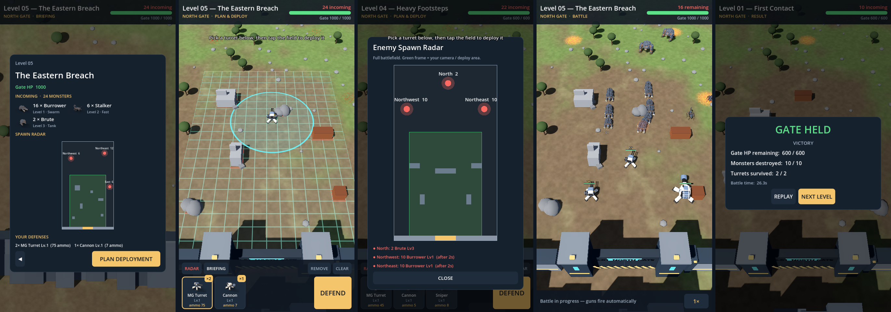

# North Gate

Tactical defense / strategy-puzzle game for Android & iOS (portrait), built in **Godot 4**.
Players study an incoming wave of underground monsters, deploy a fixed set of unmanned turrets
anywhere on the battlefield, then watch a deterministic, fully automatic battle play out.

> Plan → Deploy → Simulate → Win or Lose

## Playing / running

Open `godot/` in **Godot 4.5** and press Play (main scene: `scenes/main.tscn`).
The game is portrait 1080×1920 and uses the Mobile renderer. Export to Android/iOS
through Godot's export templates.

**Flow:** Briefing (enemy list, gate HP, spawn radar) → Plan & Deploy (pick a turret card,
tap the field; tap a placed turret to pick it up, drag to move) → **DEFEND** (fully automatic,
1×/2× speed) → Result. **Retry** keeps your deployment so you can adjust it.



### What's implemented (MVP)

- Deterministic fixed-step simulation (`scripts/sim/battle_sim.gd`), fully separate from visuals.
  The same deployment always gives the same battle; a test checks this exactly.
- Free placement on a grid anywhere in the visible field, with a range ring and valid/invalid cell
  colours. Ruins, the wall and spawn fissures can't be built on.
- Underground spawning: the fissure glows and the ground throws up dust, then the monster
  climbs out. Hotspots off-screen are simulated like any other.
- Monsters follow a flow field to the gate with no predefined roads. They go for turrets
  within their detection radius, destroy them, then carry on to the gate and attack it.
- Turrets target the closest monster automatically and have limited ammo. Cannon shells fly and
  splash, sniper beams have long range. Destroyed turrets become wrecks that no longer block movement.
- Spawn radar (full map, hotspots + counts), briefing panel, victory/defeat, retry, next level,
  saved progress.
- 5 levels in `godot/levels/*.json`, one of them the spec's "Eastern Breach". All of it is data-driven.

### Tests & balance

```bash
godot --headless --path godot --import          # once, registers classes
godot --headless --path godot --script res://tests/sim_check.gd -- trials=40 search=150
```

For every level this checks that no defence loses and that identical runs match bit-for-bit.
It also measures how many random deployments win, and hill-climbs to a winning deployment to
prove the level is solvable. Current curve, as the share of random deployments that win:
L1 62% · L2 22% · L3 22% · L4 22% · L5 8%.

Screenshots, rendered headless with Xvfb:
`godot --path godot --rendering-driver opengl3 -- level=05 phase=combat shot=out.png shot_time=20`
(phases: briefing, deploy, radar, combat, result).

## Repository layout

```
godot/
  levels/            Level data (JSON)
  scripts/sim/       defs.gd (stats), level_data.gd, battle_sim.gd: deterministic core
  scripts/game/      main.gd (flow + UI), battlefield.gd (3D view/FX/input), radar_view.gd
  tests/             sim_check.gd: determinism + balance probe
  assets/models/     Generated .glb (model x palette), textured
  assets/ui/icons/   Generated model icons
art/
  concepts/          Concept sheets
  blender/           Procedural model scripts (source of truth), see below
  previews/          Renders, colour-study sheets, TripoSR comparison
tools/triposr/       CPU TripoSR runner used for the comparison
```

## Models

| Model | Game role | Palettes | Triangles |
|---|---|---|---|
| Kestrel | MG Turret (high fire rate) | Frontier Olive, Polar Ceramic, Midnight Steel | ~8.6k |
| Mule | Cannon (AoE) | 〃 | ~10.6k |
| Needle | Sniper (long range) | 〃 | ~5.2k |
| Shale Digger | Burrower, Lv1 (swarm) | Basalt Ember, Clayfire, Abyss Violet | ~9k |
| Rift Runner | Stalker, Lv2 (fast) | 〃 | ~9k |
| Faultbreaker | Brute, Lv3 (tank) | 〃 | ~12k |


Each model has baked textures (`art/blender/ng_texture.py`): a greyscale detail map (AO, stone
grain and cracks, chipped edges) used as the base colour texture multiplied by the palette
colour, plus a normal map. Monster plates are bent into curved shells, and turret bevels are rounded.

### Conventions

- Metres, origin on the ground at the footprint centre, models face **+Z in Godot** (`MODEL_FRONT`).
- Turrets are split into `*_Base` and `*_Head`; the head's origin is on the turntable so the game
  can yaw it toward targets.
- Materials are named by palette role (`NG_primary`, `NG_armor`, `NG_seams`, `NG_glow`, …), so a
  palette can also be swapped at runtime by overriding materials. Glow/seam/eye materials are
  emissive — enable glow in the `WorldEnvironment` for the bloom.

### Rebuilding the models

With Blender 4.2+ installed:

```bash
blender --background --python art/blender/build_all.py            # everything
blender --background --python art/blender/build_all.py -- --no-render
blender --background --python art/blender/build_all.py -- --only kestrel,mule
```

Or with the `bpy` module (Python 3.11): `pip install bpy pillow && python art/blender/build_all.py`.
A full build with previews takes about 4–5 minutes on CPU.

### Not done yet

- Rigging / animation (walk, attack, emergence, turret recoil, destruction).
- The flame turret, Behemoth boss, gate and battlefield props.

## Comparing with Modly (open-source image-to-3D)

[Modly](https://github.com/lightningpixel/modly) runs open-source image-to-3D models
(Hunyuan3D 2 Mini, TripoSG, TRELLIS 2) locally and needs an NVIDIA GPU.

1. Feed it the single-object cut-outs in `art/modly_inputs/` (one per design, 1024×1024).
2. Save each result as `art/modly_outputs/<model_id>.glb` (e.g. `shale_digger.glb`).
3. Render it side-by-side with the procedural model, same camera/lights/scale:
   `python art/blender/compare_modly.py shale_digger art/modly_outputs/shale_digger.glb`
   → `art/previews/compare/shale_digger_compare.png` plus a triangle/material/texture report.

## TripoSR comparison (run in this repo, CPU only)

`tools/triposr/run_triposr.py` runs [TripoSR](https://github.com/VAST-AI-Research/TripoSR)
(MIT) on the cut-outs on CPU, about 18 s per model, writing `art/triposr_outputs/<id>.glb`.
TripoSR's `isosurface.py` needs one patch, swapping `torchmcubes` (not on PyPI) for
`skimage.measure.marching_cubes`. Background removal is built in, so `rembg` isn't needed.

Comparison renders: `art/previews/procedural_vs_triposr.png` (and `art/previews/compare/`), made with
`compare_modly.py <id> art/triposr_outputs/<id>.glb --rot=-90,0,180 --label=TripoSR --srgb_vertex_colors=1`.
