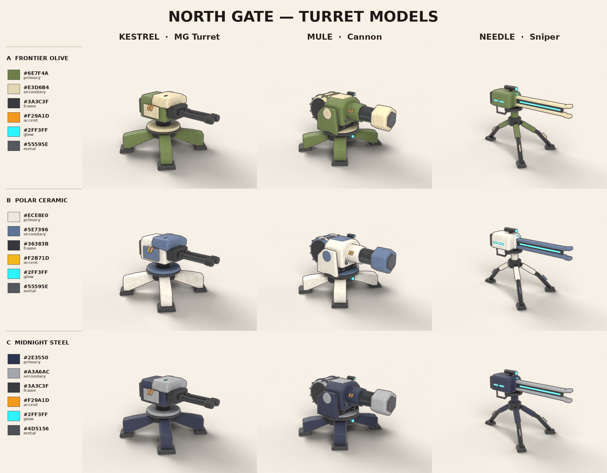
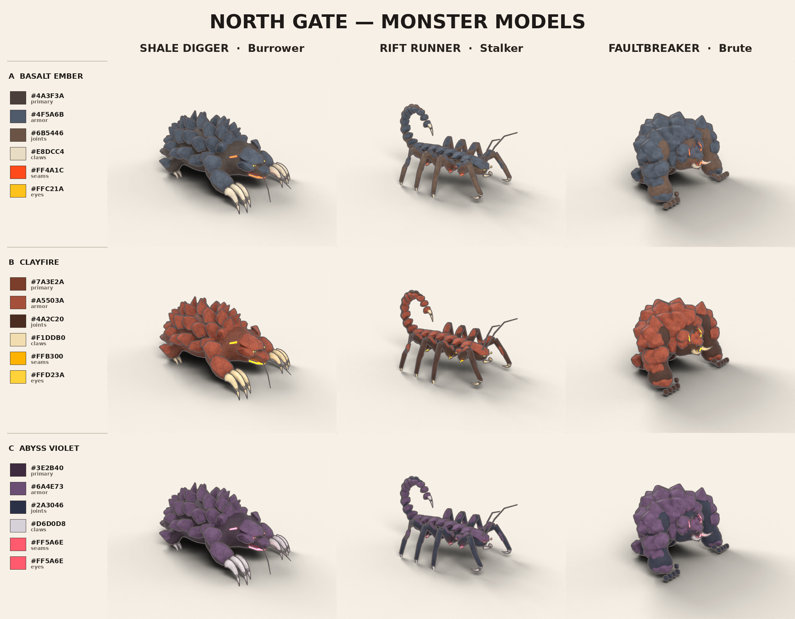

# North Gate

Tactical defense / strategy-puzzle game for Android & iOS (portrait), built in **Godot 4**.
Players study an incoming wave of underground monsters, deploy a fixed set of unmanned turrets
anywhere on the battlefield, then watch a deterministic, fully automatic battle play out.

> Plan → Deploy → Simulate → Win or Lose

## Repository layout

```
art/
  concepts/          Concept sheets (colour studies + game overview)
  blender/           Procedural Blender model scripts (the source of truth)
    ng_common.py       palettes, materials, mesh helpers, preview renderer, exporter
    ng_turrets.py      Kestrel (MG), Mule (cannon), Needle (sniper)
    ng_monsters.py     Shale Digger (Burrower), Rift Runner (Stalker), Faultbreaker (Brute)
    build_all.py       builds everything below
    models/*.blend     generated Blender files (one per model)
  previews/          Generated renders + colour-study sheets
godot/               Godot 4 project
  assets/models/     Generated .glb files, one per model × palette
  scenes/, scripts/  Model showcase scene (main scene for now)
```

## Models

| Model | Game role | Palettes | Triangles |
|---|---|---|---|
| Kestrel | MG Turret (high fire rate) | Frontier Olive, Polar Ceramic, Midnight Steel | ~7.1k |
| Mule | Cannon (AoE) | 〃 | ~8.0k |
| Needle | Sniper (long range) | 〃 | ~3.9k |
| Shale Digger | Burrower, Lv1 (swarm) | Basalt Ember, Clayfire, Abyss Violet | ~9.9k |
| Rift Runner | Stalker, Lv2 (fast) | 〃 | ~10.5k |
| Faultbreaker | Brute, Lv3 (tank) | 〃 | ~12.3k |




### Conventions

- Metres, origin on the ground at the footprint centre, models face **+Z in Godot** (`MODEL_FRONT`).
- Turrets are split into `*_Base` and `*_Head`; the head's origin is on the turntable so the game
  can yaw it toward targets.
- Materials are named by palette role (`NG_primary`, `NG_armor`, `NG_seams`, `NG_glow`, …), so a
  palette can also be swapped at runtime by overriding materials. Glow/seam/eye materials are
  emissive — enable glow in the `WorldEnvironment` for the bloom.

### Rebuilding the models

With Blender 4.2+ installed:

```bash
blender --background --python art/blender/build_all.py            # everything
blender --background --python art/blender/build_all.py -- --no-render
blender --background --python art/blender/build_all.py -- --only kestrel,mule
```

Or with the `bpy` module (Python 3.11): `pip install bpy pillow && python art/blender/build_all.py`.
A full build with previews takes about 4–5 minutes on CPU.

### Not done yet

- Rigging / animation (walk, attack, emergence, turret recoil, destruction).
- Baked texture detail (stone grain, edge wear); materials are currently flat colours + geometry.
- The flame turret, Behemoth boss, gate and battlefield props.

## Comparing with Modly (open-source image-to-3D)

[Modly](https://github.com/lightningpixel/modly) runs open-source image-to-3D models
(Hunyuan3D 2 Mini, TripoSG, TRELLIS 2) locally and needs an NVIDIA GPU.

1. Feed it the single-object cut-outs in `art/modly_inputs/` (one per design, 1024×1024).
2. Save each result as `art/modly_outputs/<model_id>.glb` (e.g. `shale_digger.glb`).
3. Render it side-by-side with the procedural model, same camera/lights/scale:
   `python art/blender/compare_modly.py shale_digger art/modly_outputs/shale_digger.glb`
   → `art/previews/compare/shale_digger_compare.png` plus a triangle/material/texture report.
